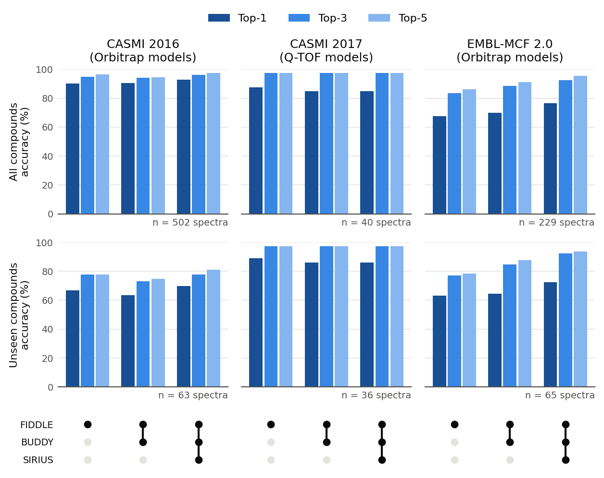

Benchmarks
==========

This page reports how often the msfiddle |release| models find the right
formula on three public benchmarks. Top-k is the share of spectra whose true
formula is among the k highest-ranked candidates.

Each benchmark is run with the models of its instrument type. CASMI 2016
(Q Exactive) uses the Orbitrap models with their release config, as
``--instrument_type orbitrap`` would. EMBL-MCF 2.0 (Orbitrap Exploris 240)
also uses the Orbitrap models, with a 50 ppm refinement window in
``fiddle_tcn_embl.yml`` because its precursor m/z errors are large. Its
spectra were acquired with stepped normalized collision energies (30, 50 and
70%), which ``scripts/embl2mgf.py`` averages and writes as NCE (``50 nce``).
CASMI 2017 uses the Q-TOF models with ``fiddle_tcn_casmi.yml``. Each benchmark
is run three ways:

- **FIDDLE**: FIDDLE's own candidates.
- **FIDDLE + BUDDY**: BUDDY's candidates added to FIDDLE's, all ranked by the
  FIDDLE rescore model.
- **FIDDLE + BUDDY + SIRIUS**: SIRIUS's candidates added as well.

Some benchmark compounds are also in the training libraries, so each result
is given twice: on all compounds, and on unseen compounds, which are absent
from the models' training and validation data. Compounds are matched on the
first block of the InChIKey, so a stereoisomer of a training compound counts
as seen. The unseen sets of CASMI 2017 and EMBL-MCF 2.0 are small, so one
spectrum moves their accuracy by several points.

         BUDDY and SIRIUS on CASMI 2016, CASMI 2017 and EMBL-MCF 2.0, on all
         and on unseen compounds.
   :width: 100%

   Top-k accuracy on all compounds (top row) and unseen compounds (bottom
   row). The dots below mark the tools each method combines.

Reproducing the results
-----------------------

From a clone of the repository, with BUDDY (``msbuddy``) and SIRIUS on the
``PATH`` and the raw benchmark files in ``data/benchmark/``:

.. code-block:: bash

   msfiddle download
   bash running_scripts/experiments_test_benchmark.sh

The raw files are the CASMI 2016 and EMBL-MCF 2.0 HRMS library exports from
`MoNA <https://mona.fiehnlab.ucdavis.edu>`_ and the CASMI 2017 challenge
files and solutions from the `CASMI contest <http://www.casmi-contest.org>`_:

.. code-block:: text

   data/benchmark/
   ├── casmi2016/MoNA-export-CASMI_2016.sdf
   ├── casmi2017/
   │   ├── Chal1to45Summary.csv
   │   ├── CASMI-solutions.csv
   │   ├── challenges-001-045-msms-mgf-20170908/
   │   └── challenges-001-045-ms-mgf-20170908/
   └── embl/MoNA-export-EMBL-MCF_2.0_HRMS_Library.sdf

The script writes top-1 to top-20 accuracy, per spectrum and per compound, to
``result/<method>_<benchmark>_eval.csv``, where the method is ``fiddle``,
``fiddle_buddy`` or ``fiddle_buddy_sirius`` and the benchmark ``casmi2016``,
``casmi2017`` or ``embl``, with an ``_unseen`` suffix for the unseen compounds.
It ends with ``scripts/plot_benchmarks.py``, which saves the figure's numbers
to ``result/benchmarks.csv`` and draws the figure.

The unseen sets come from ``scripts/remove_training_compounds.py``, which reads
the training and validation data of the models each benchmark is run with
(Orbitrap for CASMI 2016 and EMBL-MCF 2.0, Q-TOF for CASMI 2017) from
``data/cl_pkl_<DATA_TAG>/``, so that data must be present.

The `paper <https://www.nature.com/articles/s41467-025-66060-9>`_ reports the
full evaluation, including held-out test sets and comparisons with other
tools.
