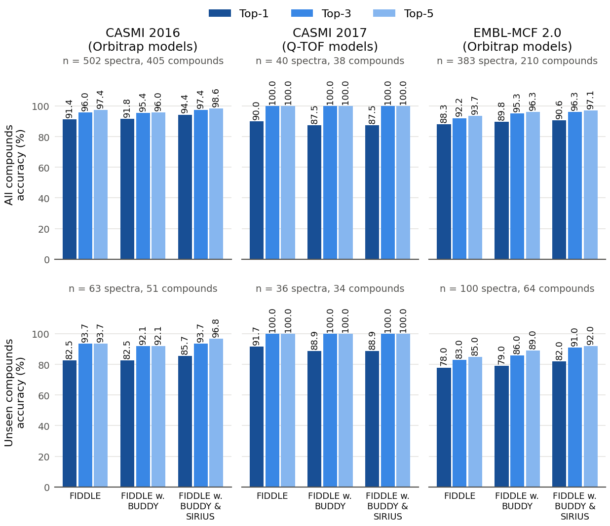

Benchmarks
==========

This page reports how often the msfiddle |release| models find the right
formula on three public benchmarks, alone and together with BUDDY and SIRIUS.
Top-k is the share of spectra whose true formula is among the k
highest-ranked candidates.

Each benchmark is run with the models of its instrument type. CASMI 2016
(Q Exactive) uses the Orbitrap models with their release config, as
``--instrument_type orbitrap`` would. EMBL-MCF 2.0 (Orbitrap Exploris 240)
also uses the Orbitrap models, with a 50 ppm refinement window in
``fiddle_tcn_embl.yml`` because its precursor m/z errors are large. Its
spectra were acquired with stepped normalized collision energies (30, 50 and
70%), which ``scripts/embl2mgf.py`` averages and writes as NCE (``50 nce``).
CASMI 2017 uses the Q-TOF models with ``fiddle_tcn_casmi.yml``; its precursor
m/z is the most intense peak of each challenge's MS1 spectrum. Every method is
given the measured precursor m/z and the adduct. Each benchmark is run three
ways:

- **FIDDLE**: FIDDLE's own candidates.
- **FIDDLE w. BUDDY**: BUDDY's candidates added to FIDDLE's, all ranked by the
  FIDDLE rescore model.
- **FIDDLE w. BUDDY & SIRIUS**: SIRIUS's candidates added as well.

SIRIUS 6.5.4 runs with its default settings. These include bottom-up formula
search, new in SIRIUS 6 and `inspired by BUDDY
<https://v6.docs.sirius-ms.io/methods-background/>`_: it looks up each
fragment and its loss from the precursor in a database of subformulas derived
from known biomolecules, and combines the matches into precursor candidates.
De novo formula generation, the only strategy of earlier SIRIUS versions, is
used only below m/z 400. FIDDLE uses no compound database.

Some benchmark compounds are also in the training libraries, so each result
is given twice: on all compounds, and on unseen compounds, which are absent
from the models' training and validation data. Compounds are matched on the
first block of the InChIKey, so a stereoisomer of a training compound counts
as seen. The unseen sets of CASMI 2017 and EMBL-MCF 2.0 are small, so one
spectrum moves their accuracy by several points.

         with BUDDY and SIRIUS on CASMI 2016, CASMI 2017 and EMBL-MCF 2.0,
         on all and on unseen compounds.
   :width: 100%

   Top-k accuracy on all compounds (top row) and unseen compounds (bottom
   row), with each bar's value.

On all compounds, per spectrum:

.. list-table::
   :header-rows: 1
   :widths: 22 30 16 16 16

   * - Benchmark
     - Method
     - Top-1
     - Top-3
     - Top-5
   * - CASMI 2016
       (502 spectra)
     - FIDDLE
     - 90.0
     - 94.8
     - 96.4
   * -
     - FIDDLE w. BUDDY
     - 90.4
     - 94.2
     - 94.6
   * -
     - FIDDLE w. BUDDY & SIRIUS
     - 92.8
     - 96.2
     - 97.4
   * - CASMI 2017
       (40 spectra)
     - FIDDLE
     - 90.0
     - 100.0
     - 100.0
   * -
     - FIDDLE w. BUDDY
     - 87.5
     - 100.0
     - 100.0
   * -
     - FIDDLE w. BUDDY & SIRIUS
     - 87.5
     - 100.0
     - 100.0
   * - EMBL-MCF 2.0
       (383 spectra)
     - FIDDLE
     - 66.6
     - 81.7
     - 85.4
   * -
     - FIDDLE w. BUDDY
     - 70.2
     - 87.7
     - 90.9
   * -
     - FIDDLE w. BUDDY & SIRIUS
     - 75.5
     - 90.3
     - 95.0

On unseen compounds, per spectrum:

.. list-table::
   :header-rows: 1
   :widths: 22 30 16 16 16

   * - Benchmark
     - Method
     - Top-1
     - Top-3
     - Top-5
   * - CASMI 2016
       (63 spectra)
     - FIDDLE
     - 66.7
     - 77.8
     - 77.8
   * -
     - FIDDLE w. BUDDY
     - 63.5
     - 73.0
     - 74.6
   * -
     - FIDDLE w. BUDDY & SIRIUS
     - 69.8
     - 77.8
     - 81.0
   * - CASMI 2017
       (36 spectra)
     - FIDDLE
     - 91.7
     - 100.0
     - 100.0
   * -
     - FIDDLE w. BUDDY
     - 88.9
     - 100.0
     - 100.0
   * -
     - FIDDLE w. BUDDY & SIRIUS
     - 88.9
     - 100.0
     - 100.0
   * - EMBL-MCF 2.0
       (100 spectra)
     - FIDDLE
     - 62.0
     - 73.0
     - 74.0
   * -
     - FIDDLE w. BUDDY
     - 65.0
     - 81.0
     - 84.0
   * -
     - FIDDLE w. BUDDY & SIRIUS
     - 69.0
     - 88.0
     - 91.0

Reproducing the results
-----------------------

The benchmark scripts are in the repository, not in the pip package. Clone the
repository at the tag of the release you want to check and install it from
the clone, so that the scripts, configs and package are the same version:

.. code-block:: bash

   git clone --branch v<release> https://github.com/JosieHong/FIDDLE.git
   cd FIDDLE
   pip install -e .
   msfiddle download

**FIDDLE alone, all compounds.** This needs nothing but msfiddle and should
give the FIDDLE rows of the table exactly:

.. code-block:: bash

   bash running_scripts/experiments_test_benchmark.sh --fiddle_only

It downloads the raw data to ``data/benchmark/`` with
``scripts/download_benchmarks.py``: CASMI 2016 and EMBL-MCF 2.0 from
`MoNA <https://mona.fiehnlab.ucdavis.edu>`_ and CASMI 2017 from the
`CASMI contest <http://www.casmi-contest.org/2017/>`_. MoNA re-exports its
libraries now and then, so the script warns when a file differs from the one
these results were computed from; the numbers can then differ too. It
converts the files to MGF, predicts with ``--eval``, and writes top-1 to
top-k accuracy to ``result/fiddle_<benchmark>_eval.csv``, where the
benchmark is ``casmi2016``, ``casmi2017`` or ``embl``.

**With BUDDY and SIRIUS, all compounds.** Install both tools first; SIRIUS
needs a free account and one login:

.. code-block:: bash

   bash running_scripts/install_buddy.sh
   bash running_scripts/install_sirius.sh
   tools/sirius.app/Contents/MacOS/sirius login -u <email> -p   # macOS
   # tools/sirius/bin/sirius login -u <email> -p                # Linux

``install_sirius.sh`` installs SIRIUS 6.5.4, the version these results come
from, into ``tools/``. Then run the same script without ``--fiddle_only``:

.. code-block:: bash

   bash running_scripts/experiments_test_benchmark.sh

It runs BUDDY and SIRIUS through ``scripts/run_buddy_sirius.py``, writes
``result/<method>_<benchmark>_eval.csv`` for the methods ``fiddle``,
``fiddle_buddy`` and ``fiddle_buddy_sirius``, and draws the top row of the
figure to ``result/benchmarks_all.png``. Results from another SIRIUS version
can differ.

**Unseen compounds.** ``running_scripts/experiments_test_benchmark_unseen.sh``
removes the compounds of the models' training and validation data with
``scripts/remove_training_compounds.py``, runs the same methods on the rest,
and draws the figure above. It needs the training data, so it can only be run
where the models were trained.

The `paper <https://www.nature.com/articles/s41467-025-66060-9>`_ reports the
full evaluation, including held-out test sets and comparisons with other
tools.
